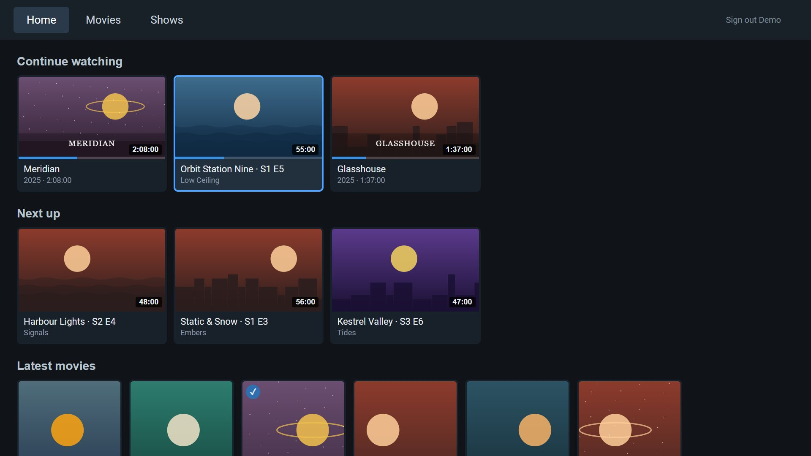
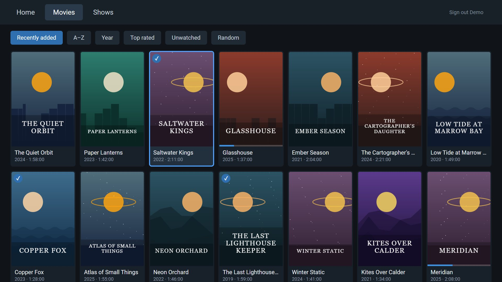
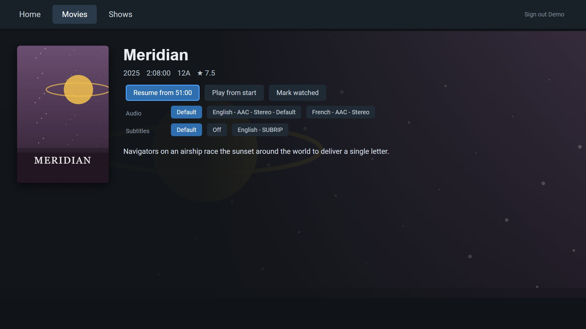
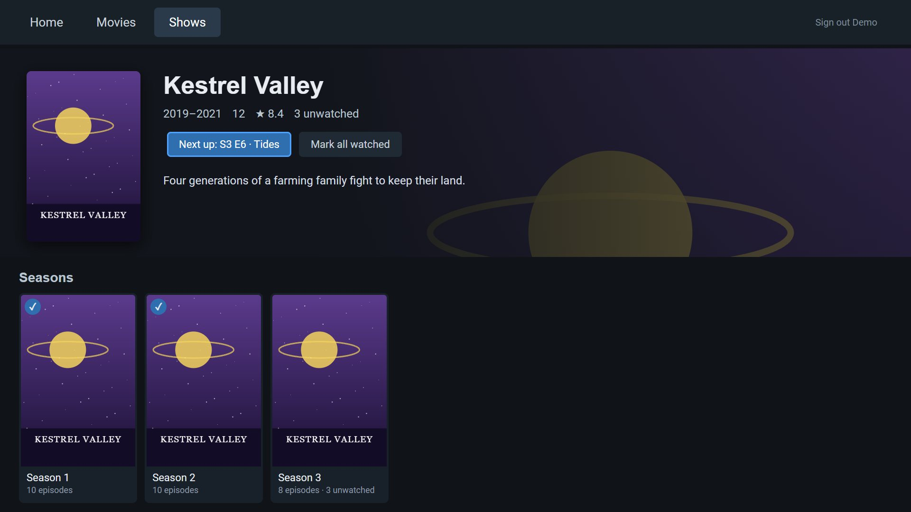
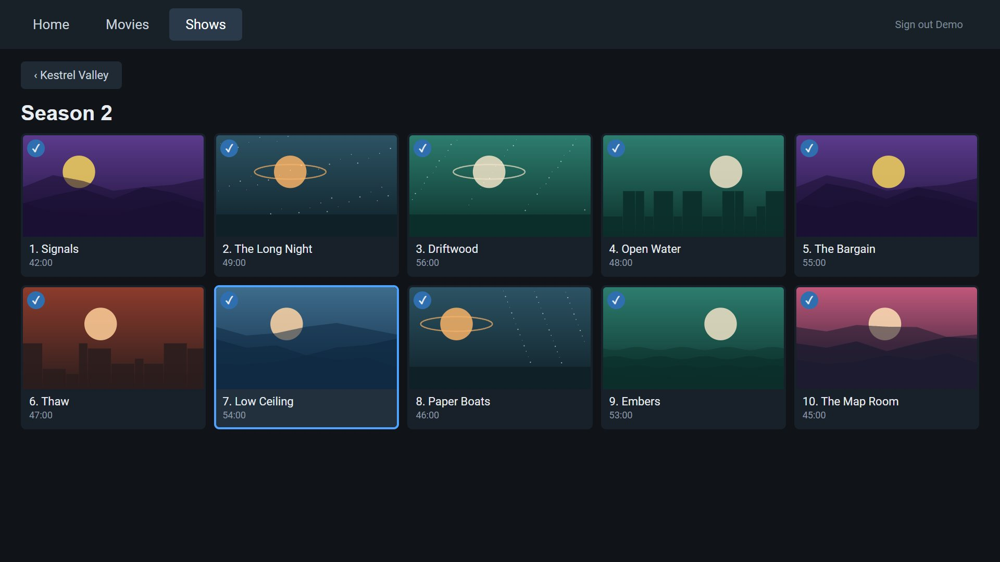
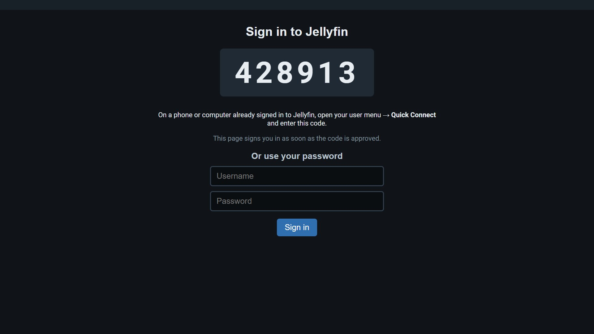

# lite-tv

A fast Jellyfin interface for **old LG TVs**.

The official Jellyfin TV apps wrap Jellyfin's web client, a large JavaScript application. On an older TV,
with a slow processor and a browser engine from years ago, it can take a very long time to become usable.
lite-tv runs next to your Jellyfin server and **builds the pages on the server**. The TV gets plain HTML
plus about 11 KB of simple JavaScript for remote-control navigation and the video player. Nothing has to
be installed on the TV: you open a URL in its browser (or install the optional launcher app).

<p align="center"></p>

**Status:** early, but usable every day. Home (Continue watching, Next up, latest movies and shows), Movies,
TV shows, playback with progress reporting, and "Up next" all work. See [docs/ROADMAP.md](docs/ROADMAP.md).

> **Note:** lite-tv is a personal project, built entirely with AI. The official Jellyfin app was frustratingly slow
> on my 2017 LG TV (webOS 3.5), and the lightweight alternatives I found either didn't support my webOS version or
> were built for newer TVs and still ran poorly on mine. So I made something that does as little as possible on the
> TV itself. See [How it's been tested](#how-its-been-tested).

## Which TVs

lite-tv is built for and tested on an **LG OLED55C7 (2017, webOS 3.5, Chrome 38)**. The pages have also been
checked in the browser engine of each older and newer webOS generation:

| LG TVs | webOS | Browser engine | Pages |
|---|---|---|---|
| 2014 | 1.x | Chrome 26 | Should work (checked in Chrome 27), not tried on a real TV |
| 2015 | 2.x | Chrome 34 | Work |
| 2016–2017 | 3.x | Chrome 38 | Work, tested on a real TV |
| 2018–2019 | 4.x | Chrome 53 | Work |
| 2020–2021 | 5.x, 6.x | Chrome 68, 79 | Work |

The older the TV, the more lite-tv helps. On a 2022 or newer TV the official Jellyfin app is usually fine.

## How it's been tested

**On a real TV.** lite-tv is used day to day on an LG OLED55C7 (2017, webOS 3.5), the TV it was built for:
browsing, signing in, and playing movies and episodes, with watched state and resume points kept in step with
Jellyfin.

**In the browser engine of every webOS generation from 2014 to 2021.** Archived Chromium builds matching each LG
TV generation (Chrome 27, 34, 38, 53, 68 and 79) were run against a real Jellyfin server, at the TV's 1920×1080:

- the sign-in "Getting ready" page, which runs jellyfin-web's device-profile builder and bitrate test
- Home, Movies, Shows, a series, a season and a movie page, with the layout measured in each engine
- remote-control (arrow key) navigation between tiles
- no script errors in any engine

These runs found real problems in the 2014-era engine (stacked tiles, stretched posters, rows wider than the
screen), which were fixed and checked again in all six engines.

**Not covered by the engine tests:** video playback (desktop Chromium lacks the TV's video decoders, so playback
has only been confirmed on the C7), and speed (a PC is far faster than a TV's processor).

**Install methods:** see the [tested and untested list](docs/INSTALL.md#how-well-tested-each-install-is) in the
install guide.

## Screenshots

<table>
  <tr>
    <td width="50%"><br><sub><b>Movies</b>: sort, page and pick with the remote</sub></td>
    <td width="50%"><br><sub><b>Movie page</b>: resume, play, audio and subtitle choice</sub></td>
  </tr>
  <tr>
    <td><br><sub><b>Series</b>: next episode and seasons</sub></td>
    <td><br><sub><b>Season</b>: episodes with watched marks</sub></td>
  </tr>
  <tr>
    <td><br><sub><b>Sign in</b> with a Quick Connect code</sub></td>
    <td></td>
  </tr>
</table>

<sub>Screenshots use the built-in demo library (`tools/demo-jellyfin.js`): invented titles and generated artwork.</sub>

## Install

lite-tv runs on any always-on computer on your network, usually the one that runs Jellyfin.
**[docs/INSTALL.md](docs/INSTALL.md)** has step-by-step instructions for
[Docker](docs/INSTALL.md#docker), [Unraid](docs/INSTALL.md#unraid), [Linux](docs/INSTALL.md#linux-without-docker),
[Windows](docs/INSTALL.md#windows) and [macOS](docs/INSTALL.md#macos).

The quickest way, with Docker:

```sh
docker run -d --init --name lite-tv --restart unless-stopped -p 6972:6972   -e JELLYFIN_URL=http://192.168.1.10:8096 -v lite-tv-data:/data ghcr.io/vibe-hacks/lite-tv:latest
```

Without Docker, all you need is Node.js 18 or later (no `npm install`):

```sh
JELLYFIN_URL=http://localhost:8096 node server.js
```

Then open `http://<that computer's IP>:6972` in the TV's browser and sign in. On LG webOS TVs you can also install
a small launcher app, so lite-tv gets its own icon on the home screen and opens full screen: see
[webos/README.md](webos/README.md).

lite-tv is meant for your home network. Don't expose it to the internet.

## Signing in

- **Quick Connect** (recommended): the TV shows a 6-digit code. Enter it in any Jellyfin app that's already
  signed in (user menu → Quick Connect). You need to turn on Quick Connect first, under Dashboard → General.
- **Username and password**, using the TV's on-screen keyboard.

lite-tv keeps the Jellyfin access token on the server and gives the TV a cookie. The device shows up in
Jellyfin under Dashboard → Devices, where you can revoke it. Sign-ins are stored in `DATA_DIR`, so treat
that folder as private: it contains Jellyfin access tokens.

## Configuration

| Variable | Default | |
|---|---|---|
| `JELLYFIN_URL` | | **Required.** Your Jellyfin server, as reachable from lite-tv |
| `JELLYFIN_UI_URL` | | Optional "Full Jellyfin" link in the header |
| `PORT` | `6972` | Listen port |
| `PAGE_SIZE` | `24` | Items per grid page |
| `DATA_DIR` | `./data` (`/data` in Docker) | Where sign-ins are stored |
| `PUID`, `PGID` | `1000` (Docker only) | User and group lite-tv runs as, and owner of `/data` (Unraid: 99 and 100) |

## Remote control

| Key | Lists | Player |
|---|---|---|
| ◀ ▶ ▲ ▼ | move between tiles | ±10 s / ±1 min |
| OK | open | play / pause |
| ⏪ ⏩ | | ±30 s |
| Back | previous page | exit |

Pointer remotes (LG Magic Remote) also work: everything is a normal link.

## How playback works

lite-tv only replaces the browsing UI. **Playback decisions are the official Jellyfin web client's:**

- **Same device profile.** On first sign-in, a one-off "Getting ready" page runs **jellyfin-web's own
  device-profile builder** (`public/jf-profile.js`, built from `vendor/jellyfin-web`) on the TV. Inside the
  webOS launcher app, it uses the same options as the official Jellyfin webOS app, including the TV's Dolby
  Atmos, Dolby Vision and HDR10 support.
- **Same bitrate.** It also runs jellyfin-web's bitrate test, and repeats it hourly as jellyfin-web does.
- **Same request.** Every `PlaybackInfo` request matches jellyfin-web's: that profile, that bitrate, and no
  forced audio or subtitle tracks (Jellyfin applies your preferences).
- **Same playback.** Direct play uses jellyfin-web's direct stream URL. Remuxes and transcodes use Jellyfin's
  HLS stream with the TV's native HLS player, as jellyfin-web does on webOS and Tizen. If direct play fails,
  lite-tv retries without it, like jellyfin-web.
- **Subtitles.** Ones Jellyfin delivers as separate WebVTT files are shown. Burned-in and in-stream subtitles
  come with the video.
- **Reporting.** Playback start, progress and stop are reported, so watched state, resume points and Next Up
  stay in step with your other apps.
- **One address for the TV.** All media goes through lite-tv, so the TV never sees Jellyfin credentials.

## Browser support

The client is plain ES5 with flexbox layout (no CSS grid, `gap` or custom properties, and no
IntersectionObserver or fetch). Flexbox rules carry `-webkit-` prefixed copies for Chrome 27 and older.

## Development

No build step and no dependencies. To work on lite-tv without your own Jellyfin, run the demo server, which has
an invented library, and sign in with any username and password:

```sh
node tools/demo-jellyfin.js                              # pretend Jellyfin on :8097
JELLYFIN_URL=http://localhost:8097 node server.js        # lite-tv on :6972
```

`public/jf-profile.js` is the one built file: see `profile/build.js` to rebuild it.

## Project layout

```
server.js             HTTP server, routing, static files
lib/config.js         environment configuration
lib/html.js           shared page, tile, grid and player markup
lib/proxy.js          media proxy (Range passthrough)
lib/http.js           cookies, forms, redirects
lib/store.js          tiny JSON store for sign-ins
backends/jellyfin.js  Jellyfin pages, playback and reporting
public/app.js         ES5 client: lazy images, D-pad navigation, player
public/app.css        styles for old TV browsers
public/setup.js       "Getting ready" page: device profile and bitrate test
public/jf-profile.js  jellyfin-web's device-profile builder, compiled to ES5 (built by profile/)
profile/              build tooling for jf-profile.js (not needed to run lite-tv)
vendor/jellyfin-web/  the jellyfin-web source files jf-profile.js is built from
webos/                optional LG webOS launcher app
tools/demo-jellyfin.js  pretend Jellyfin with an invented library (development, screenshots)
unraid/lite-tv.xml    Unraid container template
docs/INSTALL.md       installation for Docker, Unraid, Linux, Windows and macOS
```

## Licence

GPL-2.0-or-later (see `LICENSE`). lite-tv runs jellyfin-web's own device-profile code on the TV
(`vendor/jellyfin-web`, GPL-2.0-or-later), so Jellyfin decides playback exactly as it does for the
official Jellyfin apps. The webOS launcher bundles LG's `webOSTV.js` (Apache-2.0, `webos/app/webOSTV.LICENSE-2.0.txt`).

lite-tv is not affiliated with Jellyfin or LG.
